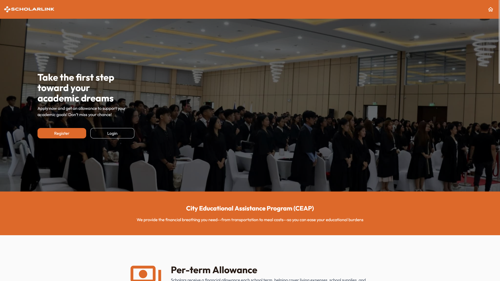
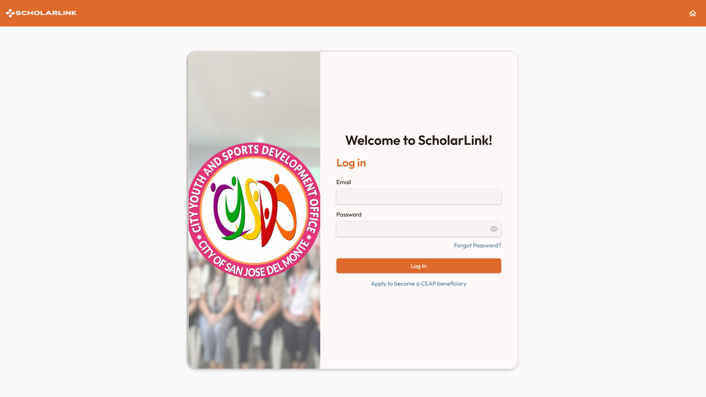
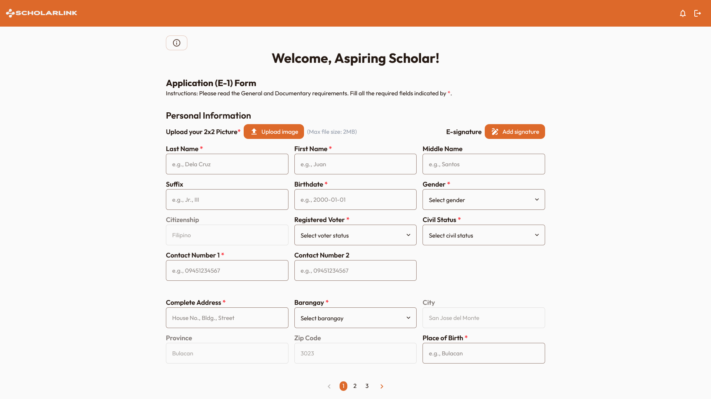
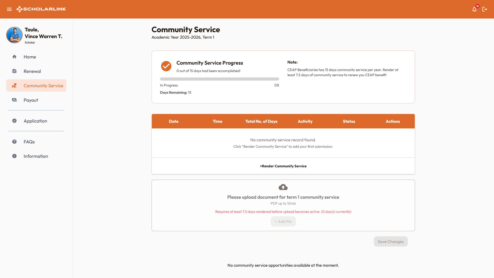
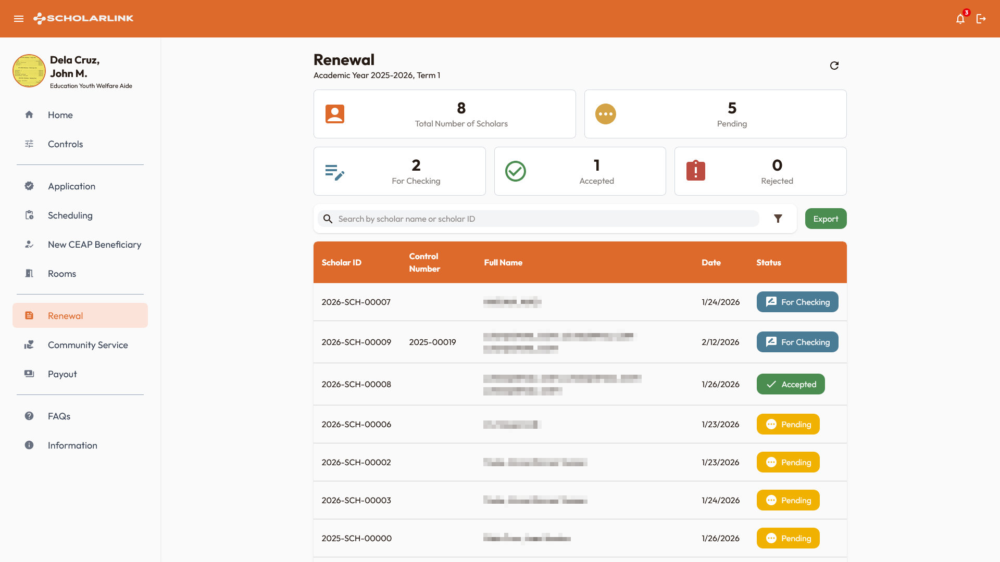

# ScholarLink — A Scholarship Management Web Application for San Jose del Monte City

> [!NOTE]
> This repository contains project documentation, screenshots, and technical information. The application's source code is maintained in a private repository. Please [contact us](#source-code-availability) for inquiries regarding access, complete screenshots, and other concerns.

## Project Overview

**ScholarLink** is a scholarship management web application developed to support the scholarship program processes of the City Youth and Sports Development Office (CYSDO) of San Jose del Monte City, Bulacan.

The system brings scholarship applications, renewals, scheduling, community service, payouts, and information sharing into a role-based platform. It provides dedicated interfaces for aspiring scholars, scholars, office personnel, head administrators, and technical administrators.

### Project Objectives

- Make scholarship application and renewal processes easier to manage and track.
- Help office personnel review records, schedule activities, and monitor scholar participation.
- Give scholars access to their application status, requirements, community service records, and payout information.
- Improve the organization and reporting of scholarship program data.

### Intended Users

| User                          | Description                                                                                                     |
| ----------------------------- | --------------------------------------------------------------------------------------------------------------- |
| Aspiring Scholars             | Submit application information and requirements, then track their application progress.                         |
| Scholars                      | Manage renewal requirements and view scholarship-related activities, community service, and payout information. |
| Education Youth Welfare Aides | Review applications and renewals; manage schedules, community service, and payout records.                      |
| Head Administrators           | View scholar data, applicant records, dashboards, and program statistics.                                       |
| Technical Administrators      | Manage user accounts, including disabled and archived accounts.                                                 |

## Key Features

### Scholarship Applications and Renewals

- Online application forms and requirements submission.
- Application status tracking for aspiring scholars.
- Staff interfaces for reviewing applicant records and results.
- Renewal forms and requirements workflows for scholars.

### Scheduling and Attendance

- Scheduling for examinations, orientations, interviews, and memorandum-of-agreement signing.
- Room and event-session management.
- QR-based attendance workflows for scheduled activities.

### Scholar Management

- Community service opportunities, submissions, and progress tracking.
- Payout batch and status management.
- Scholar records and demographic views.

### Communication and Administration

- Role-based access to dedicated application interfaces.
- In-app notifications, posts, and frequently asked questions.
- Administrative dashboards and report exports.
- User account creation, disabling, archiving, and restoration.

## Technology Stack

### Frontend

| Technology                   | Purpose                              |
| ---------------------------- | ------------------------------------ |
| React                        | Component-based web interface        |
| TypeScript                   | Static typing                        |
| Vite                         | Development server and build tooling |
| Tailwind CSS and Material UI | Interface styling and components     |
| React Router                 | Client-side navigation               |
| TanStack React Query         | Server-state management              |
| React Hook Form and Zod      | Form handling and validation         |

### Backend and Cloud Services

| Technology                   | Purpose                         |
| ---------------------------- | ------------------------------- |
| Firebase Authentication      | User authentication             |
| Cloud Firestore              | Application and program records |
| Cloud Functions for Firebase | Server-side workflows           |
| Firebase Storage             | Uploaded files and media        |
| Firebase Realtime Database   | QR session state                |
| Firebase Hosting             | Web application hosting         |
| Node.js                      | Cloud Functions runtime         |

### Development and Testing

| Technology                     | Purpose                                |
| ------------------------------ | -------------------------------------- |
| Git and GitHub                 | Version control and collaboration      |
| GitHub Actions                 | Automated tests and build checks       |
| Vitest and Testing Library     | Application testing                    |
| Firebase Emulator Suite        | Local Firebase development and testing |
| ESLint and TypeScript Compiler | Linting and type checking              |

## System Screenshots

The following screenshots demonstrate selected features and interfaces of the KipSafe system. Not all screenshots are provided due to confidentiality and privacy considerations.

### Website landing page

### Login page

### Aspiring scholar's application form page

### Scholar's community service module

### Admin's renewal module

## Source Code Availability

This repository serves as a public showcase of the KipSafe project.

The complete source code is maintained in a private repository to protect project-specific implementation details, configurations, and other non-public resources.

For inquiries about the project, its implementation, and others, feel free to contact us:

- **Icermi Ribano** (Full-Stack Developer): ribanoib@students.nu-fairview.edu.ph
- **Josh Andre Dela Cruz** (Frontend Developer): delacruzjs@students.nu-fairview.edu.ph
- **Vince Warren Taule** (Full-Stack Developer): taulevt@students.nu-fairview.edu.ph, vincewarrentaule@gmail.com, scoofszlo@gmail.com
- **Adrian Jamil Flores** (Documentation Maintainer, UI/UX Designer): floresaj@students.nu-fairview.edu.ph
- **John Aaron Hernandez** (Frontend Developer, Project Manager): hernandezje1@students.nu-fairview.edu.ph

---

_This repository is maintained for project documentation and portfolio presentation purposes._
